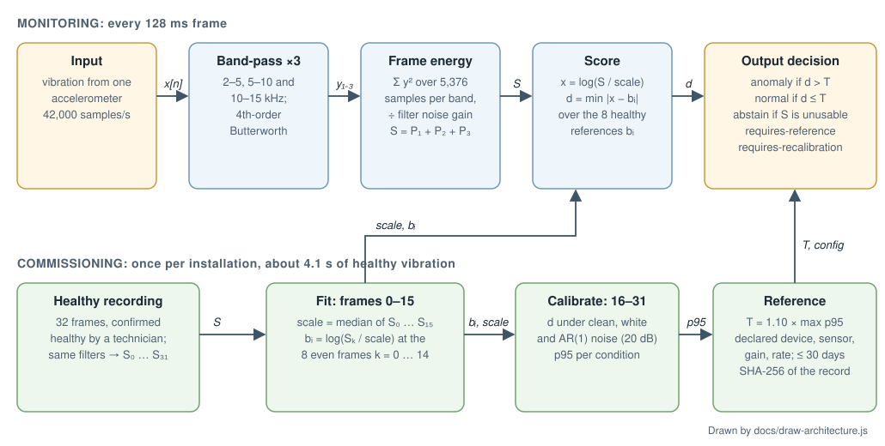

# Edge AI Inspector

An offline vibration alert for rotating machines. A technician records about four seconds of a bearing running in a known-healthy state. From then on, every 128 ms frame of accelerometer data is compared with that machine's own healthy reference, and the system answers `normal`, `anomaly`, `abstain`, `requires-reference` or `requires-recalibration`.

This is our ASUS UGen AI League Stage I entry (Workplace AI, Battlefield Lightning). Everything here runs on a laptop CPU. Nothing has been run on a UGen300 yet; that is the Stage II work described below.



The diagram is generated by `docs/draw-architecture.js` (`node docs/draw-architecture.js`).

## What each block computes

| Block | Computation | Source |
|---|---|---|
| Input | Raw acceleration `x[n]` at 42,000 samples/s. The first 500 samples warm up the filters and are not scored. | `src/uored-commissioning.js` |
| Band-pass ×3 | Three bands, 2–5, 5–10 and 10–15 kHz. Each band is a 4th-order Butterworth high-pass followed by a 4th-order low-pass, each built from two biquads (Q = 0.5412 and 1.3066). | `src/uored-envelope-dsp.js` (`biquad`), `src/uored-structure-dsp.js` (`BANDS`) |
| Frame energy | Non-overlapping frames of 5,376 samples (128 ms). Band power `Pⱼ = Σ y² / (5376 · gⱼ)`, where `gⱼ` is that band's measured white-noise gain. `S = P₁ + P₂ + P₃`. | `src/uored-scalar-kernel-r3.js` (`ScalarStream`) |
| Score | `x = log(S / scale)`; `d = min over i of |x − bᵢ|` across the 8 healthy references. | `src/uored-structure-core.js` (`decide`) |
| Decision | `anomaly` if `d > T`, otherwise `normal`. A frame with `S < 1e-24`, or with every band below `1e-24`, gives `abstain`. A missing reference gives `requires-reference`. A declared device, sensor, gain, sample-rate or algorithm change, or a reference older than 30 days, gives `requires-recalibration`. | `src/uored-structure-core.js` |
| Commissioning | 32 healthy frames (172,532 samples, about 4.1 s). Frames 0–15 fit the reference: `scale` is the median of their `S`, and `bᵢ = log(Sₖ / scale)` for the even frames k = 0, 2, …, 14. Frames 16–31 calibrate: their scores are computed clean, with white noise and with AR(1) noise at 20 dB SNR. `T = 1.10 ×` the largest of the three 95th percentiles. | `src/uored-structure-core.js` (`commission`) |

`ScalarStream` is a one-shot streaming object. It rejects non-finite samples, overflow and incomplete frames. Once a push fails, the stream stays failed; a second `finish()` or a push after `finish()` throws.

## Quick start

Requires Node.js 24 or later. There are no dependencies to install.

```
npm run demo
npm test
```

`npm run demo` runs a **synthetic** example: a two-tone signal whose first 32 frames commission the reference, with a third tone added from frame 45. It scores frames 32–76 and prints one JSON line. Expected counts: 13 `normal`, 32 `anomaly`, 0 `abstain`, threshold 0.010293.

`npm test` runs 5 tests: bit-identical features across chunk sizes compared with the reference implementation, failure handling in the stream, refused double finish, reference decisions under declared and hidden gain changes, and strict command-line parsing.

To score your own data, write one decimal sample per line:

```
node src/uored-scalar-demo-r3.js files --healthy healthy.txt --query query.txt --device-id PUMP-01 --health-confirmed --output result.json
```

The healthy file needs exactly 172,532 samples; the query needs 414,452 (500 warm-up + 77 frames). All 77 query frames are scored. Gain is fixed at 1 in this mode. Unknown or repeated options are rejected, and the output file is never overwritten. `--health-confirmed` is the operator's statement that the machine was healthy during the recording; the software cannot check it.

## Model information

There is no trained neural network and no weight file. The detector is a fixed DSP front end plus a nearest-reference rule.

| Parameter | Value |
|---|---|
| Sample rate | 42,000 Hz |
| Bands | 2–5, 5–10, 10–15 kHz |
| Filters | 4th-order Butterworth high-pass + low-pass per band |
| Warm-up | 500 samples |
| Frame | 5,376 samples (128 ms), no overlap |
| Commissioning | 32 frames: 16 fit, 16 calibrate |
| References | 8 log-relative values |
| Calibration noise | white and AR(1) (ρ = 0.8), 20 dB SNR, fixed seeds |
| Threshold | 1.10 × max of three nearest-rank 95th percentiles |
| Reference age limit | 30 days |
| Algorithm version | `uored-structure-commissioning-development-v1` |

What is learned per machine is small: `scale`, the 8 values `bᵢ`, the threshold `T` and the declared configuration. Each reference record is identified by its SHA-256.

## Performance validation

### Held-out bearings 17 and 18

Two physical bearings from the UORED dataset, held out from all method development. For each bearing, the healthy recording's first 32 frames commission the reference and its remaining 45 frames are scored; a separate cage-fault recording supplies 77 fault frames. Noise and gain changes were applied to the recordings in software.

| Condition | Healthy false alerts | Cage-fault frames detected | Abstain |
|---|---|---|---|
| Original | 0 / 90 | 154 / 154 | 0 |
| Gain ×0.5, re-commissioned | 0 / 90 | 154 / 154 | 0 |
| Gain ×2, re-commissioned | 0 / 90 | 154 / 154 | 0 |
| Query + white noise, 20 dB | 0 / 90 | 154 / 154 | 0 |
| Query + AR(1) noise, 20 dB | 0 / 90 | 154 / 154 | 0 |

Thresholds were 0.303 (bearing 17) and 0.379 (bearing 18). The highest healthy score was 0.330 (bearing 18, white noise); the lowest fault score was 3.467. Data: [`results/uored-multiband-target-validation.json`](results/uored-multiband-target-validation.json).

**Gain trap.** If the gain changes by ×0.5 or ×2 without being declared, the old reference no longer fits: every healthy frame becomes a false alert (45 / 45 on each bearing, scores 0.84–1.56), while all fault frames are still flagged. In the ideal linear case a gain `g` shifts `x` by `2 ln g` (about ±1.39). That is why a gain change has to be declared, which triggers `requires-recalibration`. Same file, `unsupportedGain`.

These results come from the reference implementation in `src/uored-structure-dsp.js`, which also computes features the decision does not use. The streaming kernel was not run on bearings 17 and 18; its equivalence was checked separately on development recordings.

### Streaming kernel parity

On 8 development recordings, the streaming kernel reproduced the reference implementation exactly: 18 reference-record hashes and 40 query-condition rows of scores and decisions matched bit for bit. For extreme but finite inputs, the reference implementation can fail inside features the kernel no longer computes. Data: [`results/uored-scalar-kernel-parity-r3-2026-10-26.json`](results/uored-scalar-kernel-parity-r3-2026-10-26.json).

### CPU cost

Intel Core Ultra 7 366H laptop, Windows, Node 24.22.1, `--single-threaded --v8-pool-size=1`. One untimed warm-up and three timed runs per recording, alternating the two implementations. Time covers stress injection, filtering, features and all decisions for one recording; reading the data file is excluded. Peak RSS is the whole Node process, including the decoded recording.

| Recording | Reference median (ms) | Kernel median (ms) | Reference peak RSS (MiB) | Kernel peak RSS (MiB) |
|---|---|---|---|---|
| H_1_0 | 531.4 | 123.4 | 101.8 | 113.1 |
| H_2_0 | 572.0 | 129.7 | 101.3 | 113.1 |
| I_3_2 | 554.7 | 136.7 | 126.4 | 126.4 |
| O_8_2 | 566.0 | 126.0 | 124.6 | 124.6 |

The kernel's median time is 4.1–4.5× lower on this host. Peak memory did not go down. Three runs per cell is a small sample. Protocol and freeze: `research/uored-scalar-benchmark-protocol-r3-2026-10-26.json` and `research/uored-scalar-benchmark-freeze-r3-2026-10-26.json`. Data: [`results/uored-scalar-benchmark-r3-2026-10-26.json`](results/uored-scalar-benchmark-r3-2026-10-26.json).

## Limits

- Two bearings on one test rig, one fault type (cage). This is a laboratory result, not evidence from a factory floor.
- The healthy test frames come from the same recording that commissioned the reference; the fault frames come from separate recordings.
- Noise and gain variation were simulated in software, not produced by real sensors or ADC settings.
- Machine health and configuration are declared by the operator, not verified by the device.
- With 16 calibration scores, the nearest-rank 95th percentile is simply the maximum. It is not a guaranteed 5% false-alert rate.
- Earlier candidate methods were tested on other UORED bearings and failed. This method was frozen on development recordings before bearings 17 and 18 were opened, and was tested on them once.
- No accelerator result exists yet.

## Stage II plan

Stage II runs on the UGen300. The CPU pipeline in this repository stays as the yardstick: same recordings, same decisions, same timing boundaries. We will run a representation the accelerator supports (for example a small spectrogram network compiled to HEF) alongside the CPU path and report what it adds in accuracy, latency or power, even if the answer is "very little". No HEF has been compiled or run so far.

## Earlier attempts and hardware notes

These records are kept for transparency. Several describe methods that failed or runs that were blocked; none of them is used by the current method.

- [`results/research-holdout.json`](results/research-holdout.json) – the first baseline, built on the Ottawa time-varying-speed bearing recordings: seven CPU variants (two of them INT8), one selected on development recordings, all evaluated once on a held-out speed profile with one healthy, one inner-race and one outer-race recording – too few to support a general claim.
- [`results/uored-paired-final.json`](results/uored-paired-final.json) – six candidate methods compared once on four paired UORED bearings (healthy and faulty recordings of each); no method passed the development gate, so the rows are descriptive only.
- [`results/uored-structure-development-2026-10-26.json`](results/uored-structure-development-2026-10-26.json) – four feature variants, including the matched scalar used here, compared on eight UORED development recordings that had already been viewed; neither structural variant was selected.
- [`results/uored-commissioning-conditional-validation-blocked.json`](results/uored-commissioning-conditional-validation-blocked.json) – the first commissioning test on bearings 16, 19 and 20 stopped at recording C_16_2, when the frozen input check rejected two samples outside its accepted range; no pass or fail was recorded.
- [`results/uored-finite-domain-amended-evaluation.json`](results/uored-finite-domain-amended-evaluation.json) – the amended run on the same bearings failed its preset screen: fault detection on C_19_2 stayed below 90% in the original and both gain-matched conditions.
- [`results/uored-multiband-target-references-lock.json`](results/uored-multiband-target-references-lock.json) – the references and thresholds for bearings 17 and 18, built from their first 32 healthy frames and locked by hash before any test frame was scored.
- [`hardware/hailo10h-feasibility.json`](hardware/hailo10h-feasibility.json) – notes on what the Hailo-10H in the UGen300 officially supports and which stages would stay on the CPU; nothing has been compiled for or run on the device.

## Repository layout

- `src/` – streaming kernel, reference implementation, commissioning and decision logic, demo CLI, and the parity and benchmark runners.
- `test/` – the 5 tests above.
- `results/`, `research/` – saved validation, parity and benchmark outputs, the earlier research records listed above, and the benchmark protocol.
- `hardware/` – the Hailo-10H feasibility notes.
- `docs/` – the block diagram and its generator.
- `datasets/ottawa-subset.json` – metadata only, needed by an import in `src/real-data.js`.
- `MANIFEST.json` – size and SHA-256 of every other file in the repository.

The parity and benchmark runners need the original UORED `.mat` files and a local data plan, which are not distributed here. The demo and tests need no external data.

## Data and credits

Bearing data: UORED, by Mert Sehri, Patrick Dumond and Michel Bouchard, Mendeley Data v5, [doi:10.17632/y2px5tg92h.5](https://doi.org/10.17632/y2px5tg92h.5), CC BY 4.0; data paper [doi:10.1016/j.dib.2023.109327](https://doi.org/10.1016/j.dib.2023.109327). No recordings are included in this repository.

Ottawa bearing data: Huan Huang and Natalie Baddour, *Bearing Vibration Data under Time-varying Rotational Speed Conditions*, Mendeley Data v1, [doi:10.17632/v43hmbwxpm.1](https://doi.org/10.17632/v43hmbwxpm.1), CC BY 4.0. `datasets/ottawa-subset.json` and the results in `results/research-holdout.json` are derived from these recordings (channel selection, anti-alias filtering, decimation and windowing). No recordings are included.

AI coding and writing assistants helped write parts of the code and documentation; the author reviewed and tested the results.

## License

MIT. See [LICENSE](LICENSE).
